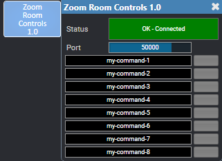

# Zoom Room Controls

A Q-SYS plugin that lets a Zoom Room control a Q-SYS design through
[Zoom Room Controls](https://support.zoom.us/hc/en-us/articles/360033716572-Room-Controls-for-Zoom-Rooms).
Each command the Zoom Room sends fires its own trigger pin.



## Setup

1. **Install.** In Q-SYS Designer 10.1 or later: at <https://library.qsys.com>,
   open **My Library > My Packages > Add Personal Package**, name it
   `Zoom Room Controls`, and use this Package URL:

   ```
   https://raw.githubusercontent.com/isaaacporter/q-sys-plugin-zoom-room-controls/main/feed/index.json
   ```

   Then in Designer, open **Tools > Show Asset Installer** and install
   `Zoom-Room-Controls`.
2. **Add the plugin** to the design and set **Command Count** (1-64) in its
   properties.
3. **Set the Port** the plugin listens on (default 50000).
4. **Enter the commands.** Type each command string the Zoom Room will send into
   a row, and wire that row's trigger pin to whatever it should do. Carriage
   returns and line feeds are ignored, so leave off delimiters.
5. **Point the Zoom Room at the Core.** In the Room Controls profile, add a
   `GenericNetworkAdapter` with `"ip": "tcp://<core-ip>:<port>"` and commands
   that match the plugin's. [sample/](sample/) has an example profile and
   design. **Status** reads *OK - Connected* once the Zoom Room connects.

## Resources

- [Jeff McAleer's Zoom Room Controls Viewer](https://zoom.jeffmcaleer.com/)
- [Control Concepts' Zoom Room Controls Profile Maker](https://controlconcepts.net/zoom/)
